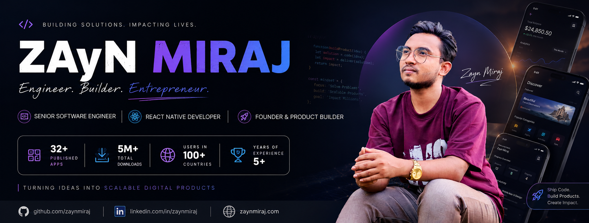

# ZAYN MIRAJ

### Senior Software Engineer · Full-Stack & Mobile Developer · AI Product Engineer

---

## About Me

I'm **Zayn Miraj**, a Senior Software Engineer with 7+ years of experience designing, developing, and delivering production-ready digital products.

I specialize in full-stack web development, cross-platform mobile applications, backend architecture, cloud infrastructure, and AI-powered software.

I enjoy working across the entire software development lifecycle — from product architecture and user experience to API development, database engineering, deployment, and application publishing.

My experience includes working on SaaS platforms, FinTech applications, e-commerce systems, healthcare solutions, productivity applications, OTT platforms, and AI-powered products.

### Engineering Focus

- Full-Stack Web Application Development
- Android & iOS Application Development
- React Native & Expo Architecture
- Backend Systems & REST API Engineering
- Database Design & Optimization
- SaaS & Multi-Tenant Architecture
- Payment Gateway & Subscription Integration
- AI & LLM-Powered Applications
- CI/CD & Cloud Infrastructure
- Open Source & Developer Tooling

---

## Technical Expertise

<table width="100%">
<tr>
<td width="50%" valign="top">

### Frontend Development

React.js · Next.js · Vue.js · TypeScript · JavaScript · Redux · Zustand

</td>
<td width="50%" valign="top">

### Mobile Development

React Native · Expo · Android · iOS · Firebase · Push Notifications · In-App Purchases

</td>
</tr>
<tr>
<td width="50%" valign="top">

### Backend Engineering

Node.js · Bun.js · Express.js · NestJS · Laravel · Python · Django · FastAPI

</td>
<td width="50%" valign="top">

### Database & ORM

MongoDB · MySQL · PostgreSQL · Prisma ORM · Sequelize · Redis

</td>
</tr>
<tr>
<td width="50%" valign="top">

### DevOps & Infrastructure

Docker · Git · GitHub Actions · CI/CD · Linux · Nginx · AWS · Vercel

</td>
<td width="50%" valign="top">

### AI & Machine Learning

OpenAI API · LLMs · MCP · RAG · AI Agents · Speech AI · TTS · Machine Learning

</td>
</tr>
</table>

---

---

## GitHub Analytics

  MY OPEN-SOURCE JOURNEY · CONTRIBUTIONS · ENGINEERING ACTIVITY

<table width="100%">
<tr>
<td width="50%" align="center">

</td>
<td width="50%" align="center">

</td>
</tr>
</table>

### Contribution Streak

### Contribution Activity

### GitHub Achievements

---

## Selected Projects

Building digital products across FinTech, SaaS, e-commerce, healthcare, productivity, and entertainment.

### Web Applications & SaaS

<table width="100%">
<tr>
<td width="50%" valign="top">

<strong> PropertyXHub</strong>

PROPERTY MANAGEMENT

Property management and digital real estate solutions.

<a href="https://propertyxhub.com">↗ Explore Project</a>

</td>
<td width="50%" valign="top">

<strong> TrustMCL</strong>

BUSINESS & FINANCIAL SOFTWARE

Web-based business invoicing and management application.

<a href="https://trustmcl.com">↗ Explore Project</a>

</td>
</tr>
<tr>
<td width="50%" valign="top">

<strong> DOB Skateshop</strong>

E-COMMERCE

Online shopping platform and mobile commerce experience.

<a href="https://dob.com.bd">↗ Explore Project</a>

</td>
<td width="50%" valign="top">

<strong> CEA Alumni</strong>

COMMUNITY & NETWORKING

Digital alumni networking and community platform.

<a href="https://ceaaust.com">↗ Explore Project</a>

</td>
</tr>
<tr>
<td width="50%" valign="top">

<strong> AKR Online Shop</strong>

E-COMMERCE

Online retail and digital shopping platform.

<a href="https://akronlineshop.com">↗ Explore Project</a>

</td>
<td width="50%" valign="top">

<strong> Penstoke</strong>

SAAS & PRODUCTIVITY

A productivity-focused SaaS platform.

<a href="https://penstoke.com">↗ Explore Project</a>

</td>
</tr>
<tr>
<td width="50%" valign="top">

<strong> Hubbers</strong>

INNOVATION ECOSYSTEM

Innovation, entrepreneurship, and digital product ecosystem.

<a href="https://hubbers.io">↗ Explore Project</a>

</td>
<td width="50%" valign="top">

<strong> AcuSolo</strong>

HEALTH & WELLNESS

Connected wellness and guided acupressure application.

<a href="https://acusolo.net">↗ Explore Project</a>

</td>
</tr>
</table>

## Mobile Applications & Digital Products

<table width="100%">
<tr>
<td align="center" width="33%">

### TypeMate AI

AI Keyboard

<a href="https://play.google.com/store/apps/details?id=com.typemate.ai">Google Play</a> · <a href="https://apps.apple.com/us/app/typemate-ai-keyboard/id6824185770">App Store</a>

</td>
<td align="center" width="33%">

### NoteCalc Pro

Smart Notes & Calculator

<a href="https://play.google.com/store/apps/details?id=com.zaynmiraj.calmaster">Google Play</a> · <a href="https://apps.apple.com/app/notecalc-pro-al-smart-notes/id6828314694">App Store</a>

</td>
<td align="center" width="33%">

### Safiora VPN

Privacy & Security

<a href="https://play.google.com/store/apps/details?id=com.safiora.vpn">Google Play</a>

</td>
</tr>
<tr>
<td align="center">

### SportsNest

Live TV & Sports

<a href="https://play.google.com/store/apps/details?id=com.sportsnest.app">Google Play</a>

</td>
<td align="center">

### AI Utility Hub

AI Productivity

<a href="https://play.google.com/store/apps/details?id=com.nimions.utilityhub">Google Play</a>

</td>
<td align="center">

### HelpsNest

Healthcare & Community

<a href="https://play.google.com/store/apps/details?id=com.helpsnest.community">Google Play</a>

</td>
</tr>
<tr>
<td align="center">

### Flatly

Shared Living

<a href="https://play.google.com/store/apps/details?id=com.myflatly.flatly">Google Play</a>

</td>
<td align="center">

### PayX Hub

Tap-to-Pay

<a href="https://play.google.com/store/apps/details?id=com.saithy.paymentxhub">Google Play</a>

</td>
<td align="center">

### PayX BIC

FinTech

<a href="https://play.google.com/store/apps/details?id=com.paymentx.bic">Google Play</a>

</td>
</tr>
</table>

### Additional Mobile Product

**Invoice Maker** — iOS invoice creation and management application.

<a href="https://apps.apple.com/om/app/best-invoice/id6736941437">View on Apple App Store ↗</a>

---

## Open Source & Developer Tools

I build reusable libraries, CLI applications, and development utilities to improve engineering workflows.

| Package | Description |
|---|---|
| [nim-glass](https://www.npmjs.com/package/nim-glass) | Glassmorphism components for React Native |
| [nim-redux-cli](https://www.npmjs.com/package/nim-redux-cli) | Redux Toolkit and RTK Query project setup |
| [nim-nodex-init](https://www.npmjs.com/package/nim-nodex-init) | Node.js and Express application scaffolding |
| [nim-ci-cd](https://www.npmjs.com/package/nim-ci-cd) | CI/CD automation utilities |
| [nim-theme](https://www.npmjs.com/package/nim-theme) | Reusable theming utilities |
| [nim-react-dropdown](https://www.npmjs.com/package/nim-react-dropdown) | Dropdown components |
| [nim-react-toastify](https://www.npmjs.com/package/nim-react-toastify) | Toast notification utilities |
| [nimion-editor](https://www.npmjs.com/package/nimion-editor) | Lightweight React rich text editor |
| [nim-git-cli](https://www.npmjs.com/package/nim-git-cli) | Git workflow utilities |
| [datetime-fcs](https://www.npmjs.com/package/datetime-fcs) | Date and time utilities |

---

## AI Research & Machine Learning

### KonthoVoice — Bengali Text-to-Speech

**KonthoVoice** is a Bengali speech synthesis project built around the CosyVoice 3 architecture.

The project explores Bengali-language text-to-speech generation, speech model development, and audio processing.

**Research focus**

- Bengali text-to-speech generation.
- CosyVoice 3-based speech synthesis.
- PyTorch and speech model experimentation.
- Audio processing and speech datasets.
- ONNX model components.
- Bengali-language AI applications.

**Base model:** FunAudioLLM/Fun-CosyVoice3-0.5B

**Model license:** CC BY-SA 4.0

### AI Engineering Interests

| Domain | Focus |
|---|---|
| LLM Engineering | OpenAI API, LLM integration |
| AI Agents | Tool calling and automation |
| MCP | Model Context Protocol |
| RAG | Retrieval-Augmented Generation |
| Speech AI | Text-to-Speech and synthesis |
| Machine Learning | PyTorch and model experimentation |
| AI Applications | Intelligent web and mobile products |

---

## GitHub Activity

---

## Currently Exploring

- Advanced iOS application development.
- Native mobile architecture.
- AI-powered product development.
- Large Language Models and AI agents.
- Model Context Protocol (MCP).
- Retrieval-Augmented Generation (RAG).
- Bengali speech synthesis.
- Scalable SaaS architectures.
- Developer experience and open-source tooling.

---

## Connect With Me

<table width="100%">
<tr>
<td width="50%" align="center">

**Facebook**

</td>
<td width="50%" align="center">

**Instagram**

</td>
</tr>
<tr>
<td width="50%" align="center">

**X / Twitter**

</td>
<td width="50%" align="center">

**GitHub**

</td>
</tr>
<tr>
<td width="50%" align="center">

**NPM**

</td>
<td width="50%" align="center">

**Hugging Face**

</td>
</tr>
</table>

---

### BUILDING PRODUCTS. SOLVING PROBLEMS. ENGINEERING THE FUTURE.

*Great software is thoughtfully engineered, beautifully designed, and successfully delivered.*

**Zayn Miraj** · Senior Software Engineer

